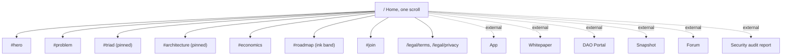
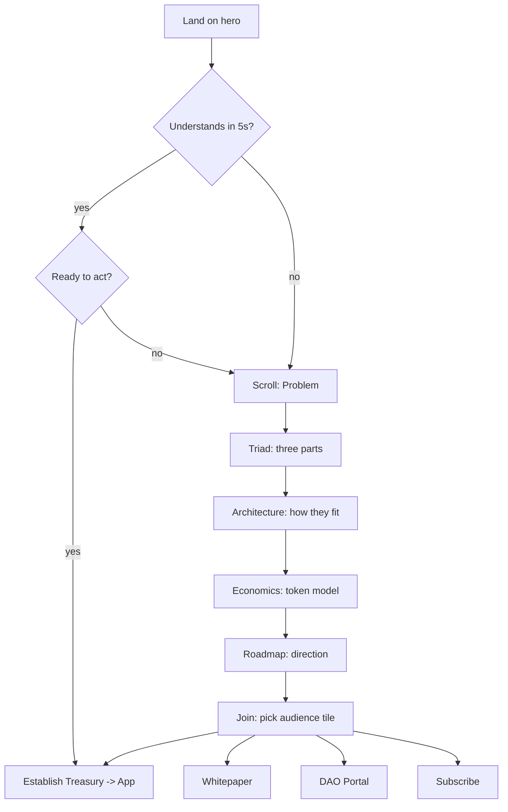
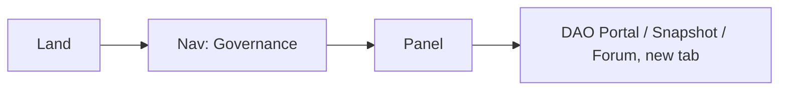
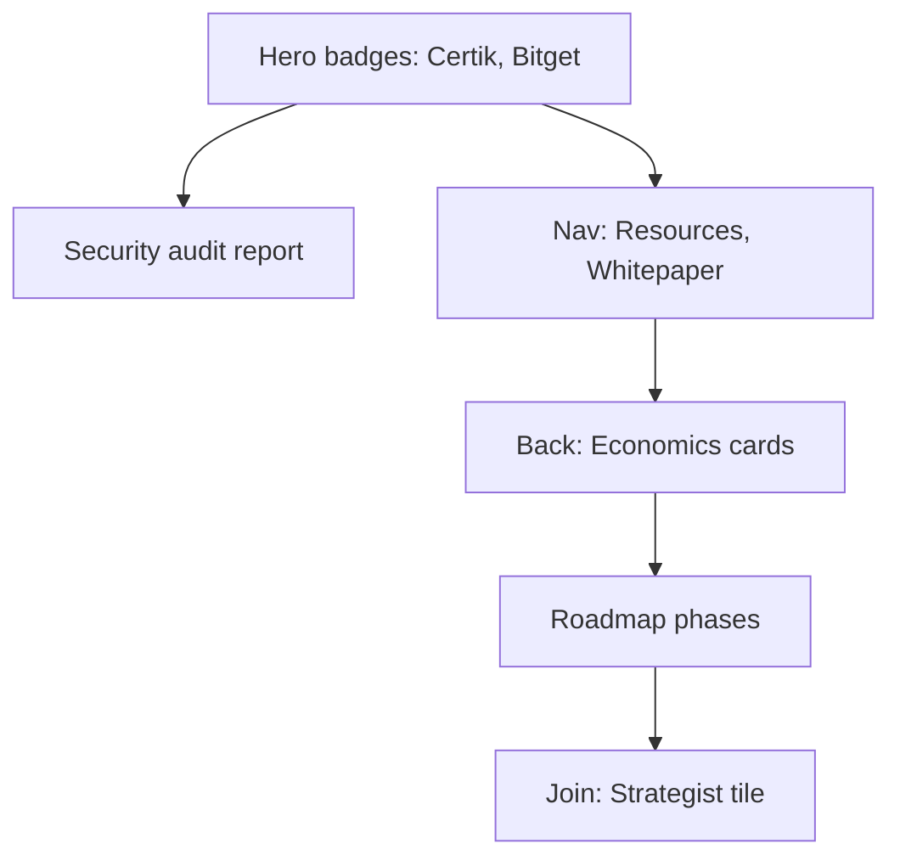
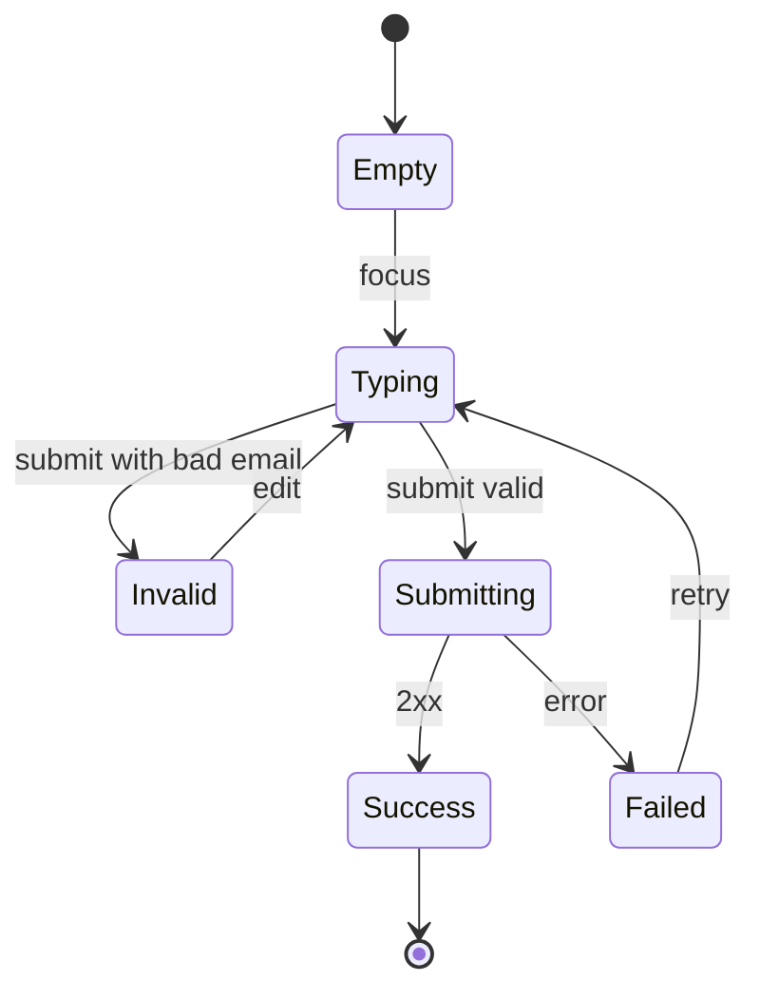

# 04 · Information architecture and user flows

> **Changed when it was built (2026-10-21).** The plan below stands except for these points, all deliberate:
> - **Nav is four plain anchors** (Infrastructure, Architecture, Economics, Roadmap), like the original, plus the language switch and "Read Whitepaper". The dropdown panels would have held one or two real items each.
> - **The problem statement is the first screen of the pinned scroller**, so section 2 and section 3 below are one section. Order is now: hero, scroller (problem, Governance Treasury, Investor Treasury, FF Token), architecture, economics, roadmap, FAQ, join, footer. Reasons in [05](05-stack-and-storytelling.md).
> - **An FAQ section was added** (8 answers that only restate facts already on the page) for answer engines. See [07](07-seo-geo-aeo.md).
> - **The newsletter form is held** until an endpoint exists, so flow F4 is not live.
> - Partner logos and the Certik and Bitget badges sit at the bottom of the hero.
> - Links with no URL show as plain text with a "Soon" chip, from one registry in `src/links.js`.

Draft for review. Content comes from the original page (`30e0b76`, see [00](00-flowfi-original.md)); anything marked **proposed** is new copy that must pass `humanize` before build. Structure follows the `landing-page` skill: one offer, one audience, one action per page, proof next to the claim it supports.

## 1. Audiences and the one action

The original CTA names three audiences. They become the page's spine.

| Audience | Question they arrive with | What convinces them | Where they should end up |
|---|---|---|---|
| **Governance architect** | Who decides, and can I take part? | Governance Treasury, voting weight, DAO tooling | DAO Portal, Snapshot, Forum |
| **Yield-seeking strategist** | Where does capital go, and is it safe? | Investor Treasury, tokenomics, Certik audit | **Establish Treasury** (app) |
| **Automated treasury / institution** | Can we migrate, and what is the standard? | Architecture, roadmap phase 03, whitepaper | Whitepaper, then app |

**Primary conversion: open the app** (hero "Establish Treasury", nav "Launch App", final CTA). Everything else is a secondary path. No app URL exists yet, so until it does the solid CTA is **Read Whitepaper** (confirmed) and the app labels return when the URL arrives (D7, interim map in section 6).

## 2. Sitemap

**Phase 1 (this revamp)** is one page plus two legal stubs. The original has no deep-dive content, and writing it now would mean inventing claims. **Phase 2** adds `/architecture`, `/economics`, `/governance`, `/security`, `/grants`, `/roadmap`, each only once the foundation supplies real copy. The nav is designed so those pages slot in without moving anything.

### Navigation

| Menu | Items | Target |
|---|---|---|
| **Protocol** | Problem · Dual-vault architecture | `#problem`, `#architecture` |
| **Economics** | Tokenomics · Black Hole Launch · Grants Program | `#economics`, `#economics`, external (TBC) |
| **Governance** | DAO Portal · Discussion Forum · Snapshot Voting | external |
| **Resources** | Whitepaper · Security Audits · Roadmap | external, external, `#roadmap` |
| Right side | EN / 中文 switch · **Launch App** | – · app |

Taiko puts 4 to 6 links under each menu. FlowFi has 2 to 3 real items per menu today, so each menu opens a small panel (title, one-line description, links) rather than a mega menu. "Core features" from the original footer is held back: nothing on the page defines it.

Footer keeps the original four columns for continuity (Architecture, Economics, Governance, Legal) with the Taiko-style community tile row above them, limited to destinations that exist: Forum, Snapshot, DAO Portal. Social tiles wait for real handles.

## 3. Home page map

Order is the argument: *what it is → why it matters → what it is made of → how it fits → what the token does → where it goes → what you do next.*

| # | Section | Question it answers | Content (source) | Taiko pattern | Action | Motion | Mobile |
|---|---|---|---|---|---|---|---|
| 0 | **Nav + rail** | Where am I? | Menus above | Floating pill, left dot rail | Launch App | – | Pill, sheet menu, no rail |
| 1 | **Hero** | What is this? | H1 "FlowFi is Capital, Governed." Sub: "Decentralized infrastructure for governing, deploying and compounding capital on-chain." (V1 positioning). Partner row: ENI, Debox, DAOaaS, AseanLabs. Badges: Certik Audited, Bitget Wallet Partner (moved up from the original footer) | Centred headline, 1 solid + 2 outline pills, 3D mark in blueprint frame | **Read Whitepaper** (interim solid; becomes Establish Treasury with the app URL) · View Architecture · View Governance | Mark tilts to pointer (decorative), ribbon shimmer | CTAs stack full-width, never clip |
| 2 | **Problem** | Why does this exist? | "Web3 capital has scaled. **Governance hasn't.**" + "Passive treasuries suffer from non-productive stagnation. Millions in community assets sit dormant because the tools for audited deployment don't exist." Art: `web3.svg` | Letter-reveal statement in a hairline grid (Taiko About) | – | Scrubbed letter opacity, once | Words reveal on enter, no scrub |
| 3 | **Triad** | What is it made of? | Three screens: **1 Governance Treasury** (Rule & Consensus, 1.2B FF locked) · **1 Investor Treasury** (Execution & Growth, $10M+ seed) · **1 FF Token** (1B cap, no inflation). Intro screen title **proposed**: "Three parts, one system." | Pinned horizontal scroller (Taiko Scaling). Ribbons in logo colours replace pink swooshes | Explore Governance · View Portfolio · Read tokenomics | **Pin 1**, linear scrub | Stacked cards, no pin |
| 4 | **Architecture** | How do the treasuries work together? | Left callout "Governance", right callout "Investor" (plain annotations with a leader line, not tags, D5), the mark between them filling in. Titles from original: "Rule & Consensus." and "Execution & Growth." Body: the two original descriptions | Mark outline→fill morph (Taiko Explore) | Explore Governance | **Pin 2**, 1.5 viewports | Static filled mark, two cards |
| 5 | **Economics** | What does the token do? | "The Black Hole Launch." + original description. 4 cards: Capped Supply (1 Billion FF, no minting) · Fair Launch Distribution (no VC pre-allocations) · Ecosystem First (50%) · Deep Collateral (over-collateralised). Art: `FFtoken`, `Fairlaunch`, `ecosystem`, `collact` SVGs | Card bento on hairline grid | Read tokenomics | Reveal on enter | 1 column |
| 6 | **Roadmap** | Where is it going? | "Long-term Infrastructure." Phase 01 System Launch / Genesis Governance (Active) · 02 Expansion / Backflow Optimization (In Progress) · 03 Global Tier / Enterprise Scaling (Planned). No dates | Dark band, three cards (D1). Flat baseline, skew optional | Read Whitepaper | Reveal | Vertical timeline |
| 7 | **Join** | What do I do next? | Original CTA as three tiles: *Governance architect* → DAO Portal · *Yield-seeking strategist* → Establish Treasury · *Automated treasury* → Whitepaper. Newsletter form held until an endpoint exists (D7) | Taiko footer-tile row, scaled up | One tile click | Reveal | Tiles stack |
| 8 | **Footer** | Anything else? | Columns, badges, status, © 2026 FlowFi Foundation | Community tiles + 4 columns | – | – | Columns collapse to 2×2 |

Proof placement: Certik and partner logos sit in the hero (claim: "audited deployment") and again beside the Economics "Deep Collateral" card, not only in the footer.

Not included on purpose: yield simulator, dated roadmap, FAQ. A FAQ would help the strategist and institution audiences (custody, audit scope, fees) but needs real answers from the team. **Proposed** for phase 2.

## 4. User flows

### F1 · First visit to conversion (primary)

### F2 · Governance participant, return visit

Two clicks, no scrolling. Links open in a new tab with `rel="noopener noreferrer"` and a ↗ marker.

### F3 · Due diligence

### F4 · Newsletter (deferred, D7)

No endpoint exists, so the form is not rendered in phase 1. The states below apply once one does.

Inline message under the field, `aria-live="polite"`, button disabled only while submitting. Endpoint unknown (D7).

### F5 · Language

EN ⇄ 中文 is instant, no animation, persisted in `localStorage` (`flowfi_lang`, already used). **Gap:** `setLanguage()` does not set `<html lang>`, so the `:lang(zh)` type rules in the tokens would never fire. Fix when wiring the system. Crawlers only see English at one URL; a `/zh` route is the proper fix if Chinese search matters.

### F6 · Motion off or small screen

Under 768px or `prefers-reduced-motion: reduce`: no pins, screens stack in DOM order, reveals are instant. Content order and tab order are identical in both modes.

## 5. Page-level requirements

| Area | Requirement |
|---|---|
| Keyboard | Skip-to-content link; menu opens with Enter, closes with Esc, focus returns to trigger; visible focus ring on every control; pinned screens are reachable by Tab in reading order |
| Semantics | One `<h1>`; sections are `<section aria-labelledby>`; decorative frames, ribbons, dots `aria-hidden` |
| Performance | One font family, 3 weights, preload 400 + 500; hero image `fetchpriority="high"`; GSAP loaded only ≥768px with motion allowed; canvas paused when off-screen |
| SEO | Title, meta description, Open Graph and Twitter card, `Organization` JSON-LD; `lang` on `<html>` |
| Events (vendor-neutral names) | `cta_click{id}`, `section_view{id}`, `persona_click{id}`, `subscribe_{submit,success,error}`, `lang_change`, `external_click{host}` |

## 6. Content and asset gaps to close

| Need | Why | Owner |
|---|---|---|
| App URL, DAO portal, Snapshot space, forum, Certik report, grants page | Placeholders today. Keep them in one registry (`src/links.js`, to create) and fail the production build while any entry is still `#` | FlowFi team |
| Whitepaper | **Known:** `https://flowfi.gitbook.io/flowfi` (redirects from `flowfi.gitbook.io`, page title "Overview \| FlowFi"). Checked 2026-10-21 | Done |
| Newsletter endpoint | F4 is deferred until it exists | FlowFi team |
| Social handles | Footer tiles and nav icons | FlowFi team |
| Whether "ENI Mainnet" is live | The roadmap says "transition to ENI Mainnet"; do not show a status pill until it is real | FlowFi team |
| Terms, Privacy | `/legal` stubs | Legal |
| Chinese copy for any new line | New headlines are English-only so far | Translator |
| FAQ answers | Phase 2 | FlowFi team |

### Interim link map (only the gitbook is real)

**Confirmed 2026-10-21.** Applies until the app URL exists, so no primary control is dead. Swap back by editing the registry and three labels.

| Control | Interim label and target |
|---|---|
| Hero solid button, nav CTA | **Read Whitepaper** → `https://flowfi.gitbook.io/flowfi` (new tab). Returns to "Establish Treasury" / "Launch App" when the app URL arrives |
| Hero outline buttons | **View Architecture** → `#architecture` · **View Governance** → `#triad` |
| Roadmap, Economics "Read tokenomics", footer Tokenomics and Black Hole Launch | `https://flowfi.gitbook.io/flowfi` |
| Persona tiles | Governance architect → `#triad` · Yield-seeking strategist → `#economics` · Automated treasury → whitepaper |
| DAO Portal, Forum, Snapshot, Security audits, Grants | Rendered as plain text with a "Soon" chip, not as links, so nothing points at `#` |
